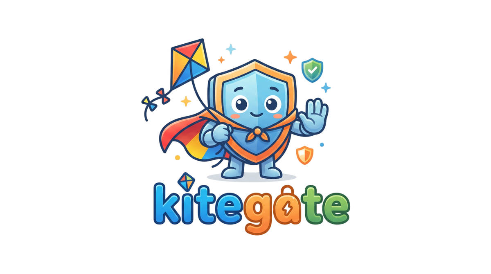

# Kitegate



A safer question-answering setup for young children, enforced at the gateway
rather than only in a prompt. "Safer", not "safe": no filter is perfect, and
the test suite here is published so you can judge it yourself.

**Quick start:** `docs/quickstart.md` covers every setup. For a ready-made
children's chat site, run `deploy/openwebui/setup.sh` (or double-click
`start.cmd` on Windows): it starts Open WebUI behind the Kitegate gateway, with
your model provider or a local model.

## For parents

You bring the model: a provider API key, or a small one running on your own
machine. Kitegate sits between your child and it as a checkpoint. Every
question a child types and every reply that comes back is screened before
anyone sees it, and the screening runs outside the model, so it holds when the
model misbehaves or a child talks it round. Setup is one command, or a
double-click on Windows. You get a chat site on your own machine, you are its
admin, and each child gets a sign-in.

- **A child cannot wander off.** Children's accounts are tied to one screened
  model, kids-encyclopedia. Every other model answers them with a short
  refusal. In the ready-made bundle, web search, code execution, image
  generation, sharing and arena models are off as well, and the front end has
  no connection except the gateway.
- **A child in trouble gets a person, not a refusal.** Checked before anything
  else: "I'm scared", "someone hurt me", "don't tell Mum", "I have no friends"
  and the like get the trusted adult your pack names, the words "you are not
  in any trouble", and Childline on 0800 1111 in case the named adult is the
  problem. Set `KITEGATE_ALERT_WEBHOOK` to be told when it happens.
- **The tool cannot pose as your child's friend.** No model may claim to be a
  person, say it loves a child, comment on their appearance, flirt or play out
  a relationship, however often it is asked. Replies are checked for this on
  the way out, so it does not rest on the model's cooperation.
- **Hard blocks on the unambiguous**, in both directions: pornography and
  nudity, suicide and self-harm methods, eating disorders, drugs and vaping,
  weapon-making, gore, strong language. Narrow by design, so Scunthorpe and
  peacocks still get an answer.
- **Personal details stay off the network.** Phone numbers, postcodes, email
  addresses, "I live at...", "my school is called..." stop the question being
  sent at all, with a reply saying why.
- **You choose the values, not a model provider.** A pack sets who a child is
  sent to, which topics go to that person (romance, puberty, gambling, death,
  political opinion), the wording of every reply and the framing the model is
  given.
- **The framing is yours too.** A pack tells the model how to speak to a child:
  reading level, neutral wording where people disagree, no personal questions.
  `uk-school`, for one, asks for a hint or the first step on homework before a
  full answer. A pack adds to the core's own framing and cannot replace it.
  That framing tells the model, in every pack, what each core check is there to
  stop: posing as a person or a friend, adult or dangerous material, asking for
  personal details, and leaving a child alone with distress. The checks screen
  the reply anyway; the framing means fewer replies need replacing.
- **The front end cannot out-rank it.** The gateway's system message is the
  only one a children's model gets. A front end's own system prompt is folded
  in after the core and the pack, ranked below them, or dropped
  (`KITEGATE_CLIENT_SYSTEM=drop`).
- **Pictures are screened, not forbidden.** A child sees a photograph only if
  it came from a curated source (a Wikipedia article's lead image, NASA's
  public library) *and* a moderation model did not object to it. Both checks
  are on by default; the scan needs an OpenAI key, which setup reuses from your
  provider when that is OpenAI. No key means no pictures, because an unscanned
  one is never shown, and `KITEGATE_IMAGE_POLICY=block` turns them off
  outright. Open image search is deliberately not offered. The gateway fetches
  the photographs itself when the model asks for one, so there is nothing to
  install in Open WebUI or LibreChat.
- **You can see what happened.** Blocks go to a log you can read, and distress
  can alert you. That log is what children typed, so treat it as sensitive.

| Pack | Sensitive topics go to | Suits |
|---|---|---|
| `secular-neutral` | a parent or carer | home, no particular worldview |
| `christian-family` | Mum or Dad | Christian homes; also hands over questions about sexual orientation and gender identity, and says so in its description |
| `uk-school` | your teacher | classrooms; written against the DfE generative AI product safety standards |

No pack can switch off any part of the safety core. The core is pattern
matching, so it misses deliberate misspellings, other languages and meaning
spread across several messages; see [Limitations](#limitations) for the rest,
and read `docs/regulation.md` before children use any of this.

## How it works

Two layers, in a fixed order:

- **Safety core** (`src/kitegate/core.py`), the same for everyone:
  distress detection first (a child saying they are hurt or frightened is sent
  to a trusted adult and Childline, never given a refusal), then hard blocks on
  adult and dangerous material, then personal details kept off the network,
  then a reply-side check that the tool has not presented itself to the child
  as a person, a friend or a romantic interest.
- **Values pack** (`src/kitegate/packs/`), chosen per deployment: who
  the child is sent to, which topics go to that person, reply wording and
  framing. Three reference packs ship, in the table above. A pack cannot
  switch off any part of the core. The neutral packs redirect romance whoever
  it is between and answer questions about every kind of family.

## Use it

```bash
pip install .            # from a clone; the core needs only PyYAML and cryptography
```

```python
from kitegate import PolicyEngine, load_pack

engine = PolicyEngine(load_pack("uk-school"))
verdict = engine.screen_request(["why do volcanoes erupt?"])
```

## Signed packs

A pack decides who a child is sent to and what the replies say, so packs are
signed. Each `pack.yaml` has a detached Ed25519 signature in `pack.yaml.sig`.

- Bundled packs must carry the project's signature, always. A changed bundled
  pack will not load.
- Your own packs are checked against the public keys you trust. A signature
  that does not match, or comes from a key you have not trusted, is always
  refused. Unsigned packs load with a warning unless you require signatures.

```bash
kitegate-pack keygen --out ~/.kitegate --name family-packs   # once; keep the .pem private
kitegate-pack sign my-pack.yaml --key ~/.kitegate/family-packs.pem
kitegate-pack verify my-pack.yaml --key ~/.kitegate/family-packs.pub
```

Where packs are loaded, set `KITEGATE_PACK_KEYS` to your public key (comma
separated for several) and `KITEGATE_REQUIRE_SIGNED_PACKS=true`. Keep the private key off
any machine that serves children: whoever holds it can sign packs you trust.

## Deploy it: one gateway for every front end

```
Open WebUI ──┐
LibreChat  ──┼──► kitegate ──► NeMo Guardrails (optional) ──► model
your app   ──┘
```

The gateway (the `kitegate` command, or the Docker image) is an
OpenAI-compatible endpoint (`/v1/chat/completions`,
`/v1/models`). For a children's model it refuses known child accounts on any
other model, screens the child's newest message and the tool results in the
history, asks upstream for the whole reply, screens it, and only then answers
(replaying it as a stream if asked). Blocks come back as a normal reply in the
pack's words, with a `kitegate` verdict object alongside for apps that record
them. Distress goes to an optional block log and alert webhook.

Photographs come from the gateway too. For a children's model it offers the
model one tool, `find_photo`, and runs it itself: the model asks for "tiger",
the gateway screens that subject, fetches the Wikipedia article's lead image,
hands it back, and the child gets one screened answer with the picture in it.
The front end never sees the round trip, so every front end gets pictures
with nothing installed. `KITEGATE_PHOTOS` picks the providers (`wikimedia` by
default, `nasa` for space) or turns the tool `off`; it is off anyway when
pictures are blocked. The model needs tool calling; one without it answers in
words.

```bash
pip install ".[gateway]"                    # or the Docker image below
cp adapters/gateway/gateway.env.example adapters/gateway/gateway.env   # fill it in
docker compose -f adapters/gateway/docker-compose.yml up -d --build
```

All settings are environment variables, listed in
`src/kitegate/gateway/config.py`.

| Front end | How |
|---|---|
| Open WebUI, new install | `deploy/openwebui/`: one command starts Open WebUI and the gateway, set up as below |
| LibreChat | `adapters/librechat/`: a custom endpoint with `x-kitegate-user-email: '{{LIBRECHAT_USER_EMAIL}}'` |
| Open WebUI | `adapters/openwebui/gateway-connection.md`: one OpenAI connection to the gateway, forwarded user headers |
| your own app | any OpenAI SDK with `base_url` set to the gateway; send `x-kitegate-user-email`, and `x-kitegate-pack` if packs differ per child |

**NeMo Guardrails** (optional) adds NemoGuard content-safety classifiers after
the deterministic core: `docker compose ... --profile nemo` and
`KITEGATE_UPSTREAM_KIND=nemo`. Config is in `adapters/nemo/config/`. The gateway
asks NeMo for the whole reply, reads which rail stopped it, and answers in the
pack's words; a self-harm (S6) or sexual-minor (S7) flag on the child's
message gets the distress reply and an alert. Run the NemoGuard model
yourself: NVIDIA's hosted endpoints are for evaluation only and must not
receive personal data.

### Transport security

Children's messages, their email and the gateway key cross every hop.

- The gateway refuses to start if an upstream, passthrough or webhook URL is
  plain `http://` to anything but loopback or a single-label Docker service
  name (`nemo`, `kitegate`). `KITEGATE_ALLOW_INSECURE_UPSTREAM=true`
  overrides that for a path you have protected another way.
- It binds `127.0.0.1` by default. The Docker image binds `0.0.0.0` inside the
  container and the compose files publish no port, so it is reachable only on
  the Docker network.
- If a front end is on another host, serve TLS: set `KITEGATE_TLS_CERT`
  and `KITEGATE_TLS_KEY`, or put a TLS reverse proxy (Caddy) in front.
  Client certificates (mutual TLS) at that reverse proxy stop a stolen key
  being replayed from elsewhere.
- NeMo's server has no authentication: never publish its port.
- The block log is what children typed when blocked. Treat its volume as
  sensitive data at rest.

## Routers

LiteLLM or another router is not an adapter but an upstream. Point
`KITEGATE_UPSTREAM_URL` at it and keep front ends off it
(`docs/quickstart.md`, section 5). Every front end goes through the gateway;
there is no in-process Open WebUI filter any more, because it could not alert
an adult, screen pictures, run the photo tool or own the system prompt.

## Limitations

- The core is pattern matching. It misses misspellings, letter-spelling
  tricks, other languages and meaning spread across several messages. Use the
  NeMo stage, or another classifier, for those.
- Pictures in a reply are checked by a hosted moderation model against
  thresholds well below its own flagging line, and only from an allowlisted
  host. That is screening public pictures before display, and **not** a CSAM
  control: the `sexual/minors` category is text-only upstream. Without
  `KITEGATE_IMAGE_SCAN_API_KEY` there is nothing to check with, so pictures
  are removed instead. Children's own uploads are refused unless
  `KITEGATE_IMAGE_UPLOADS=allow`, and are never scanned.
  `docs/quickstart.md` section 9 has the detail.
- The framing is guidance. A model can ignore it, and a folded client system
  prompt still reaches the model; the reply checks are what hold either way.
  Adult passthrough models get no framing and their system prompts are left
  alone.

Before deploying to children, read `docs/regulation.md`. Nothing here is
legal advice.

## Develop

```bash
pip install -e ".[dev]"
pytest
```

The commit hooks run a secret scanner and a Python SAST pass over what you
are about to commit, and the test suite before a push. Install them once per
clone, along with TruffleHog, which pre-commit deliberately does not build
for itself:

```bash
scoop install trufflehog      # or: brew install trufflehog
pip install pre-commit
pre-commit install --install-hooks
```

`docs/hooks.md` covers what each hook is for, how to get past a false
positive, and what to do if `pre-commit install` refuses because another tool
already owns your git hooks path.

Changing a bundled pack needs a new project signature, so the tests fail
until a maintainer re-signs it (`kitegate-pack sign src/kitegate/packs/*.yaml
--key <project key>`). Propose pack changes in a pull request as usual; the
maintainer signs on merge.

See `docs/testing.md` for how the suite is organised, and `CONTRIBUTING.md`
for the commit message format that releases are cut from.

## Security

Report vulnerabilities privately; see `SECURITY.md`.

## Licence

Apache-2.0. See `LICENSE`.
